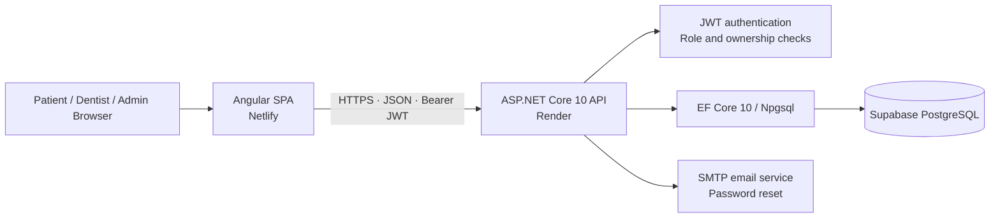
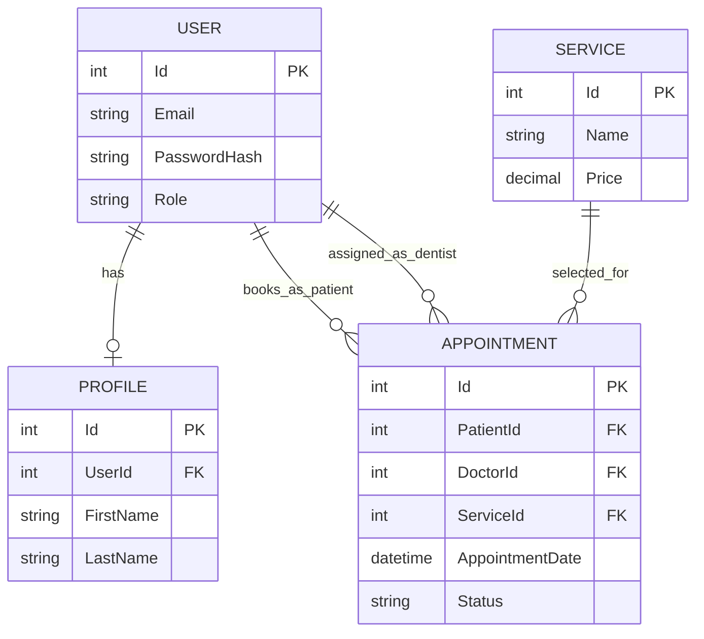
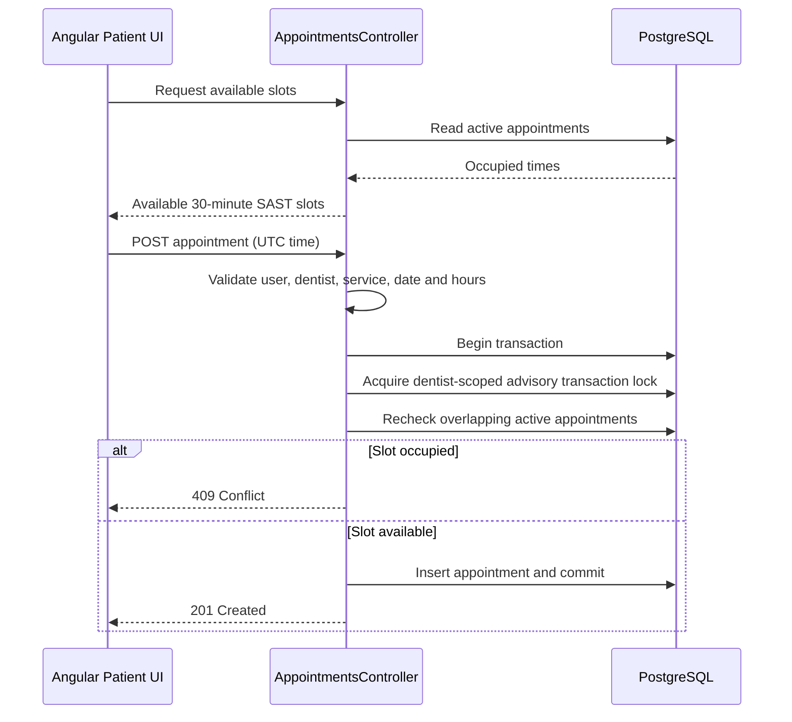
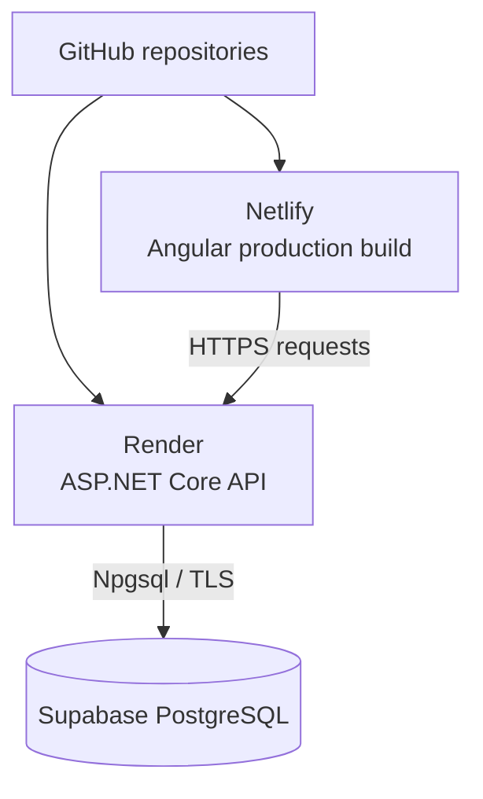

# BrightSmile Dental — System Architecture

> Technical architecture of the deployed BrightSmile Dental portfolio application. This document describes the implementation rather than proposing an unimplemented architecture.

## 1. System context

BrightSmile Dental is a browser-based dental practice management application. Patients can manage appointments and profiles; dentists manage assigned appointments; administrators manage services, patients, dentists and reporting.

The system consists of a separately deployed Angular single-page application (Netlify), an ASP.NET Core 10 REST API (Render), and a managed Supabase PostgreSQL database. The browser communicates with the API over HTTPS using JSON and JWT bearer authentication. Database access is performed by the backend, not the browser.

## 2. Technology choices

| Layer | Implementation | Responsibility |
| --- | --- | --- |
| Presentation | Angular, TypeScript, Angular Material | Forms, dashboards, navigation and HTTP requests |
| API | ASP.NET Core 10 controllers | REST endpoints, business rules and response codes |
| Security | JWT bearer authentication, BCrypt, ASP.NET Core authorization | Authentication, role checks and password hashing |
| Persistence | Entity Framework Core 10, Npgsql | Entity mapping, queries, migrations and transactions |
| Database | Supabase PostgreSQL | Persistent accounts, profiles, services and appointments |
| API reference | OpenAPI / Swagger generation, Scalar | Interactive endpoint and schema documentation |
| Hosting | Netlify frontend; Render API | Separate frontend and backend deployments |

This is a controller-based layered application. It is **not** described as Clean Architecture or microservices.

## 3. Backend components

The API exposes seven controller groups:

| Controller | Responsibilities |
| --- | --- |
| Auth | Patient registration, login, password reset |
| Users | Current account details, administrator patient lookups |
| Profiles | Authenticated profile retrieval and update |
| Services | Public service catalogue and administrator service management |
| Dentists | Public directory and administrator dentist management |
| Appointments | Availability, booking, rescheduling, cancellation and status updates |
| Reports | Administrator appointment analytics |

DTOs define input and output contracts, while data annotations validate supported request fields. `ApplicationDbContext` provides EF Core persistence. `JwtService` issues tokens, and `EmailService` supports email workflows.

## 4. Data relationships

The same `User` entity represents patients, dentists and administrators, distinguished by role. Appointment relationships identify a patient, a dentist and a service. The diagram is a simplified conceptual model, not a complete column-level database schema.

## 5. Authentication and authorization

1. The client sends login credentials to `POST /api/Auth/login`.
2. The API validates the account and BCrypt password hash, then issues a JWT.
3. The Angular client includes the JWT as `Authorization: Bearer <token>` on protected requests.
4. ASP.NET Core validates the token signature, issuer, audience and expiry.
5. Controller role attributes and resource-level ownership checks restrict access.

The roles are **Admin**, **Dentist** and **Patient**. Public service and dentist-directory reads do not require authentication. Angular route guards assist navigation but are not a security boundary; backend authorization remains authoritative.

## 6. Appointment booking and concurrency

Appointments are 30 minutes long, Monday–Friday, 09:00–17:00 South African Standard Time. Accepted starts are on the hour or half-hour; the last start is 16:30. Requests use UTC timestamps, and the backend converts to SAST to enforce business hours. Pending and Confirmed appointments reserve slots. Database transactions and dentist-scoped PostgreSQL advisory locks serialize conflicting scheduling operations.

## 7. Reporting

The administrator reporting endpoint aggregates appointment records into date-filtered totals, status breakdowns, daily trends, popular services and dentist workload. Estimated completed or scheduled service values are **not** evidence of payment collection or recognized revenue.

## 8. Deployment and configuration

- Frontend: https://brightsmiledentalfrontend.netlify.app/
- Backend API base: https://brightsmiledentalbackend.onrender.com/api
- Scalar route: `/api-docs` **when `ApiDocumentation:Enabled=true` is configured in the deployed API**.
- OpenAPI JSON: `/swagger/v1/swagger.json` when documentation is enabled.
- CORS currently allows the Netlify frontend origin and local Angular development origin.
- Production secrets such as database credentials, JWT signing keys and SMTP settings belong in deployment configuration, not source control.
- Development startup applies EF Core migrations and seeds demo users; this is not presented as an automatic production migration mechanism.

## 9. Quality and limitations

The frontend and API are deployed and connected. Manual API scenarios are documented in the repository README. Automated unit/integration tests, concurrency load tests, CI/CD quality gates and production email-delivery verification remain separate engineering improvements; this document does not claim they are complete.

## 10. Further reading

- [Backend README](../README.md)
- [Frontend repository](https://github.com/AriesMaster/BrightSmileDentalFrontEnd)
- [Live application](https://brightsmiledentalfrontend.netlify.app/)
- [Scalar API documentation](https://brightsmiledentalbackend.onrender.com/api-docs) — requires production API documentation to be enabled.
