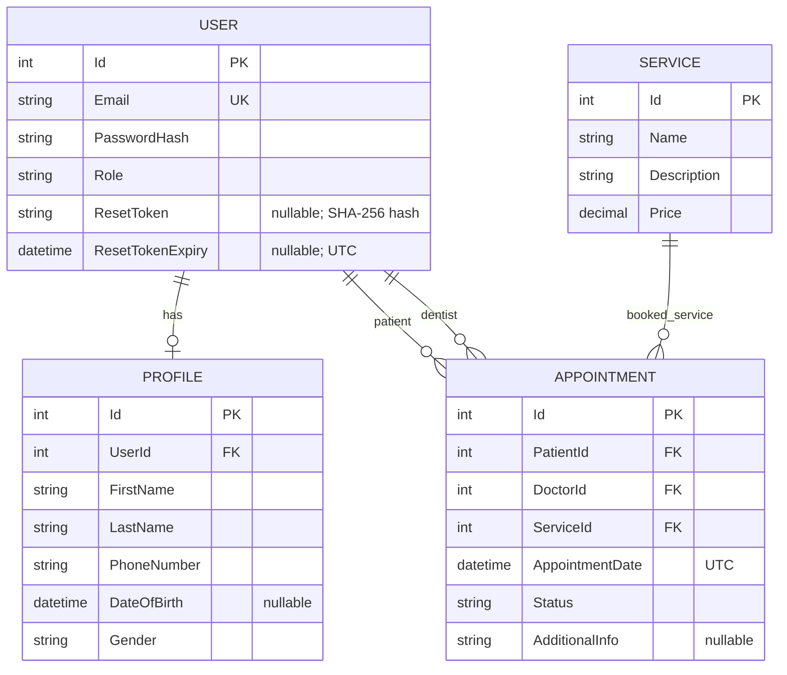

# BrightSmile Dental — Database Design and Data Dictionary

> This document describes the EF Core entity model and relationship configuration in the backend repository. It is **not** a live database schema export; exact PostgreSQL column types, generated index names and migration history should be verified against the applied migrations and Supabase database.

## 1. Database overview

BrightSmile Dental uses Supabase PostgreSQL with Entity Framework Core 10 and the Npgsql provider. `ApplicationDbContext` exposes four main entity sets: `Users`, `Profiles`, `Services` and `Appointments`.

## 2. Entity relationship diagram



**Cardinalities:** A user has zero or one profile; a profile belongs to one user. Each appointment references exactly one patient account, one dentist account and one service. A user may appear in many appointments in either the patient or dentist relationship.

## 3. Data dictionary

### Users

| Property | C# type | Purpose |
| --- | --- | --- |
| `Id` | `int` | Primary key |
| `Email` | `string` | Login identifier; unique index configured |
| `PasswordHash` | `string` | BCrypt password hash, not plaintext |
| `Role` | `string` | Account role: Admin, Dentist or Patient; defaults to Patient in the model |
| `ResetToken` | `string?` | Optional SHA-256 hash of a generated password-reset token |
| `ResetTokenExpiry` | `DateTime?` | Optional reset-token expiry, compared with UTC |

The model's older inline comment describes `ResetToken` as a plain random token; **the current AuthController implementation hashes the generated token before storage**. The property name is retained for compatibility.

### Profiles

| Property | C# type | Purpose |
| --- | --- | --- |
| `Id` | `int` | Primary key |
| `UserId` | `int` | Foreign key to `Users.Id`; one-to-one relationship |
| `FirstName` | `string` | Given name |
| `LastName` | `string` | Family name |
| `PhoneNumber` | `string` | Contact number |
| `DateOfBirth` | `DateTime?` | Optional date of birth |
| `Gender` | `string` | Optional demographic information represented as a string |

### Services

| Property | C# type | Purpose |
| --- | --- | --- |
| `Id` | `int` | Primary key |
| `Name` | `string` | Service name |
| `Description` | `string` | Service description |
| `Price` | `decimal` | Listed price in South African rand |

The API checks service-name duplicates case-insensitively, but the current `ApplicationDbContext` does **not** explicitly configure a database-level unique index on service names. Do not confuse application validation with a database constraint.

### Appointments

| Property | C# type | Purpose |
| --- | --- | --- |
| `Id` | `int` | Primary key |
| `PatientId` | `int` | Foreign key to `Users.Id`, identifying the patient |
| `DoctorId` | `int` | Foreign key to `Users.Id`, identifying the dentist |
| `ServiceId` | `int` | Foreign key to `Services.Id` |
| `AppointmentDate` | `DateTime` | Appointment start timestamp in UTC |
| `Status` | `string` | Booking lifecycle status; defaults to Pending |
| `AdditionalInfo` | `string?` | Optional patient-supplied notes |

The current booking workflow uses Pending, Confirmed, Completed and Cancelled statuses. The backend enforces permitted transitions rather than relying on a database enum.

## 4. Relationship and integrity configuration

The following are explicitly configured in `ApplicationDbContext.OnModelCreating`:

- A **unique index** on `User.Email`.
- A **one-to-one** relationship from `User` to `Profile` through `Profile.UserId`.
- An appointment-to-patient foreign key through `Appointment.PatientId` with `DeleteBehavior.Restrict`.
- An appointment-to-dentist foreign key through `Appointment.DoctorId` with `DeleteBehavior.Restrict`.
- An appointment-to-service relationship through `Appointment.ServiceId`; no explicit delete behavior is set in the current configuration.

EF Core conventions and migrations determine additional schema details. This document does not claim a database-level exclusion constraint for appointment overlaps.

## 5. Scheduling consistency and concurrency

The API validates the appointment's UTC timestamp against operating hours in SAST (UTC+02:00), Monday–Friday, 09:00–17:00, with 30-minute start intervals. It treats Pending and Confirmed bookings as occupying time.

For booking and schedule-changing operations, the API uses database transactions, dentist-scoped PostgreSQL transaction advisory locks and an overlap query. The overlap check compares time intervals rather than just equal timestamps. This is **application-managed concurrency protection**; it is not a declared PostgreSQL exclusion constraint.

## 6. Security and sensitive data

- Passwords are stored as BCrypt hashes.
- Password-reset tokens are generated randomly; the current controller persists a SHA-256 hash and an expiry rather than the usable token.
- API endpoints enforce JWT-based role and ownership checks; those are **application authorization rules**, not PostgreSQL row-level security policies.
- Profiles and appointments contain personal data. Do not include production records, JWTs, password hashes or connection strings in public documentation or screenshots.
- The Angular application accesses database records only through the backend API.

## 7. Migrations and schema verification

EF Core migrations version the database structure. To inspect the configured migration history locally, from the directory containing the API project:

```bash
dotnet ef migrations list
```

To inspect the actual deployed schema, use Supabase's SQL editor or database inspection tools with appropriate read-only access. Verify column nullability, PostgreSQL types, unique indexes, foreign-key delete actions and applied migrations before treating this document as an exact physical schema specification.

## 8. Related documentation

- [System architecture](ARCHITECTURE.md)
- [Backend README](../README.md)
- [Interactive API reference](https://brightsmiledentalbackend.onrender.com/api-docs) — requires production documentation to be enabled.
