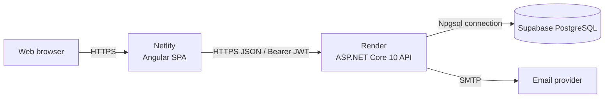

# BrightSmile Dental — Deployment and Operations Guide

**Application:** BrightSmile Dental  
**Frontend:** Angular 21.2, Netlify  
**Backend:** ASP.NET Core 10, Render  
**Database:** Supabase PostgreSQL  
**Status:** Frontend and backend deployed and connected. Hosting dashboard configuration and operational procedures should be verified by the maintainer.

## 1. Deployment architecture



| Component | Production location |
| --- | --- |
| Frontend | https://brightsmiledentalfrontend.netlify.app/ |
| API base | https://brightsmiledentalbackend.onrender.com/api |
| Scalar API reference | https://brightsmiledentalbackend.onrender.com/api-docs — requires production configuration |
| OpenAPI document | https://brightsmiledentalbackend.onrender.com/swagger/v1/swagger.json — requires production configuration |
| Database | Supabase managed PostgreSQL; credentials are not published |

The frontend production environment file is `BrightSmileDentalFrontEnd/src/assets/environments/environment.prod.ts` in the separate frontend repository. It currently sets `apiUrl` to `https://brightsmiledentalbackend.onrender.com/api`.

## 2. Repository layout and prerequisites

Backend repository: https://github.com/AriesMaster/BrightSmileDentalBackEnd  
Frontend repository: https://github.com/AriesMaster/BrightSmileDentalFrontEnd

Requirements for local builds:

- .NET 10 SDK and the `dotnet-ef` CLI tool for migrations.
- Node.js compatible with Angular 21.2 and npm for the frontend.
- PostgreSQL access, preferably a dedicated development database.
- A JWT signing key of at least 32 UTF-8 bytes.
- Docker, if building the supplied backend container.

The backend project is in `BrightSmileDEntal/`. The Angular workspace is in the nested `BrightSmileDentalFrontEnd/` directory of the frontend repository.

## 3. Backend environment variables

ASP.NET Core environment variables use double underscores (`__`) to represent configuration colons (`:`).

| Variable | Required | Purpose |
| --- | --- | --- |
| `ConnectionStrings__DefaultConnection` | Yes | Npgsql connection string to PostgreSQL |
| `Jwt__Key` | Yes | Secret signing key, at least 32 UTF-8 bytes |
| `Jwt__Issuer` | Yes | Expected JWT issuer, typically `BrightSmileDental` |
| `Jwt__Audience` | Yes | Expected JWT audience, typically `BrightSmileDentalUsers` |
| `ASPNETCORE_ENVIRONMENT` | Deployment-specific | Environment name; production should not use Development |
| `ASPNETCORE_URLS` | Container-specific | Listener URL; Dockerfile sets `http://+:10000` |
| `ApiDocumentation__Enabled` | Optional | Set `true` to serve Scalar and OpenAPI in production |
| `App__ClientUrl` | Password recovery | Angular origin used to construct reset links |
| `Smtp__Host` | Email delivery | SMTP server hostname |
| `Smtp__Port` | Email delivery | SMTP server port |
| `Smtp__Username` | Email delivery | SMTP username |
| `Smtp__Password` | Email delivery | SMTP credential |
| `Smtp__From` | Email delivery | Sender address; code falls back to username if omitted |

Never commit live values. Use Render's environment configuration and .NET user secrets for local development.

## 4. Backend build and Docker

The repository-root `Dockerfile` uses a multi-stage .NET 10 build:

1. Restore and publish the API using the .NET 10 SDK image.
2. Copy the published output to an ASP.NET Core 10 runtime image.
3. Listen on port `10000`.
4. Start `BrightSmileDEntal.dll`.

From the backend repository root:

```bash
docker build -t brightsmile-api .
docker run --rm -p 10000:10000 --env-file .env brightsmile-api
```

The local `.env` file must provide the required configuration keys, for example `ConnectionStrings__DefaultConnection` and `Jwt__Key`. Do not commit it. The Dockerfile confirms container support, but the current repository does **not** contain a root `render.yaml`; the exact Render build/deploy settings must be checked in Render.

For a non-container local build:

```bash
cd BrightSmileDEntal
dotnet restore
dotnet build -c Release
dotnet run
```

The checked-in launch profiles use HTTP `http://localhost:5243` and HTTPS `https://localhost:7094`. Actual ports depend on how the application is launched.

## 5. Database provisioning and migrations

The API uses EF Core migrations with Npgsql. To apply migrations **deliberately** to a selected database:

```bash
cd BrightSmileDEntal
dotnet ef migrations list
dotnet ef database update
```

**Important:** `Program.cs` automatically runs `Database.MigrateAsync()` and demo-user seeding **only when the environment is Development**. It does not automatically apply migrations in Production.

For production schema changes:

1. Create and review an EF Core migration locally.
2. Test the migration against a non-production database.
3. Take or verify a recoverable production database backup.
4. Apply the reviewed migration to the intended production database using controlled credentials.
5. Deploy the matching API version and verify core endpoints.

Do not point development seeding or test scripts at production. Supabase backup availability, retention and restore capabilities depend on the actual project configuration and plan; verify them in the Supabase dashboard.

## 6. Frontend build and Netlify

From the frontend repository:

```bash
cd BrightSmileDentalFrontEnd
npm ci
npm run build
```

The Angular production build uses `src/assets/environments/environment.prod.ts` via `fileReplacements`. Its `apiUrl` currently points to the Render backend and includes `/api`.

Deploy the resulting Angular browser output using the actual build and publish-directory settings in Netlify. The exact Netlify dashboard build command, publish path and SPA rewrite rule were **not** verified in this review; do not substitute a guessed output path. Confirm direct navigation to protected routes works after refreshing the browser.

The backend CORS policy currently allows the Netlify origin and `http://localhost:4200`. If the frontend domain changes, update the backend's permitted origins and redeploy it.

## 7. Render API deployment

The deployed API address is `https://brightsmiledentalbackend.onrender.com`.

The following is a safe **verification and deployment checklist**, not a claim that all Render settings have been inspected:

1. Open the correct Render service and confirm the linked GitHub repository/branch.
2. Check whether the service uses the repository Dockerfile or a native .NET build/start command.
3. Confirm the service listens on the port expected by Render; the supplied Dockerfile uses `10000`.
4. Verify database and JWT environment variables are configured securely.
5. Review pending migrations before deploying schema-dependent changes.
6. Deploy the revision and inspect startup logs for configuration, database or migration errors.
7. Test public and protected API behavior, then the Angular end-to-end journey.

## 8. Enable and verify Scalar in production

The backend source includes `app.MapScalarApiReference("/api-docs", ...)`, but documentation is **disabled by default outside Development** unless `ApiDocumentation:Enabled` is explicitly set.

In Render, add:

```text
ApiDocumentation__Enabled=true
```

After the service restarts or redeploys, verify:

- https://brightsmiledentalbackend.onrender.com/api-docs
- https://brightsmiledentalbackend.onrender.com/swagger/v1/swagger.json

Swagger **UI** (`/swagger`) is only mapped in Development; production Scalar and the JSON document are separately configurable.

Publishing documentation does **not** remove JWT or role authorization from the API. Avoid publishing privileged example tokens or real patient data.

## 9. Post-deployment smoke tests

| Check | Expected result |
| --- | --- |
| Open Netlify homepage | Angular app loads without a fatal runtime error |
| Fetch public services from Angular | Request reaches Render and returns service data |
| Fetch public dentist directory | Directory loads from the deployed API |
| Login with a dedicated test account | JWT authentication succeeds |
| Open an authorized dashboard | Role-specific data loads |
| Attempt a forbidden operation with a low-privilege test account | API rejects the request |
| Create and cancel a disposable test appointment | Booking rules and database persistence behave as expected |
| Open Scalar after enabling documentation | Interactive reference and OpenAPI JSON load |
| Review Render logs | No unhandled startup errors or leaked secrets |

Use dedicated non-production test accounts and avoid changing real patient data during checks.

## 10. Troubleshooting

| Symptom | Likely checks |
| --- | --- |
| Render service fails to start | Missing `ConnectionStrings__DefaultConnection`, JWT settings, container port or database connectivity |
| Browser shows CORS error | Frontend origin matches `AllowAngularApp`; deployed API is reachable |
| Angular calls localhost in production | Verify production file replacement and Netlify rebuild |
| API returns 401 | JWT present, unexpired and signed for configured issuer/audience |
| API returns 403 | Role or resource-ownership authorization denies the operation |
| Scalar returns 404 | Set `ApiDocumentation__Enabled=true`, redeploy and inspect logs |
| Database schema error | Compare applied EF migrations with deployed API version |
| Password-reset email not received | Check SMTP configuration, provider restrictions and server logs |
| Angular deep-link refresh fails | Verify Netlify SPA fallback/rewrite configuration |
| Appointment returns 409 | Check overlapping Pending/Confirmed appointments and permitted status changes |

## 11. Rollback and recovery

- **Frontend:** Revert to a known-good Netlify deployment if available in the account.
- **Backend:** Redeploy a known-good Render revision or image using the actual configured deployment mechanism.
- **Database:** Schema rollback is **not automatically safe**. Review migration compatibility and restore procedures before applying destructive changes.
- **Secrets:** Rotate compromised credentials and redeploy services that consume them.

The specific rollback controls, backup schedules and recovery targets have not been audited; document these after checking the hosting dashboards.

## 12. Related documents

- [Architecture](ARCHITECTURE.md)
- [Database design](DATABASE.md)
- [Requirements](REQUIREMENTS.md)
- [Security](SECURITY.md)
- [Backend README](../README.md)
