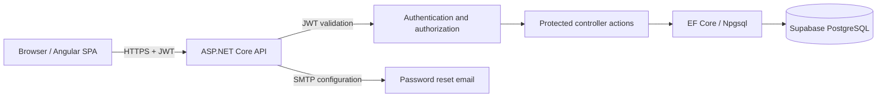

# BrightSmile Dental — Security Design

> **Scope:** Source-based review of the BrightSmile Dental ASP.NET Core API. This document describes implemented controls and known verification gaps. It is **not** a penetration-test report, formal security certification or guarantee of production security.

## 1. Security boundaries

The browser is an untrusted client. Angular route guards improve navigation, but all sensitive access decisions must be enforced by the API. The API uses application credentials to access PostgreSQL; this architecture does not claim PostgreSQL row-level security.

## 2. Authentication and JWT

`AuthController.Login` looks up an email address and verifies the submitted password using `BCrypt.Net.BCrypt.Verify`. On success, `JwtService` issues a signed JWT containing:

| Claim | Source |
| --- | --- |
| Name identifier | User ID |
| Email | Normalized account email |
| Role | Stored account role |

Tokens use **HMAC-SHA256**, with a **three-hour expiry**. `Program.cs` configures bearer-token validation for issuer, audience, expiry and signing key, with a one-minute clock skew. Startup rejects a missing JWT key or a key shorter than 32 UTF-8 bytes.

**Important limitation:** The implementation does not demonstrate token revocation or refresh tokens. A signed JWT remains valid until expiry unless the signing key changes or additional server-side revocation is introduced.

## 3. Authorization

The application defines three roles: **Admin**, **Dentist** and **Patient**.

| Resource / operation | Visitor | Patient | Dentist | Admin |
| --- | --- | --- | --- | --- |
| View public services and dentist directory | Yes | Yes | Yes | Yes |
| Register and log in | Yes | Yes | Yes | Yes |
| View or update own profile | No | Yes | Yes | Yes |
| Book an appointment | No | Yes | No | No |
| View own patient appointments | No | Yes | No | No |
| View assigned dentist appointments | No | No | Yes | No |
| Manage permitted appointment status changes | No | No | Assigned dentist | Yes |
| Cancel eligible appointment | No | Own appointment | No | Yes |
| Manage dental services | No | No | No | Yes |
| Create dentist accounts | No | No | No | Yes |
| View patient directory and reporting | No | No | No | Yes |

The table summarizes intended and implemented controller access; individual operations also validate the current user's identity and the target record. A user possessing a valid JWT is **not** automatically authorized to access another user's records.

## 4. Password storage and recovery

- Registration hashes passwords using BCrypt.
- Login verifies BCrypt hashes rather than comparing plaintext passwords.
- The forgot-password endpoint returns a generic success message whether or not the supplied email exists, reducing email-account enumeration.
- Password-reset tokens are generated with `RandomNumberGenerator.GetBytes(64)` and encoded for transmission.
- The API stores **SHA-256 hashes** of reset tokens, not the usable reset tokens themselves.
- Reset tokens expire after **one hour** and are cleared after successful use.
- The controller logs email-delivery errors and returns a generic success response.

**Verification gap:** Successful production SMTP delivery and the complete reset-password journey require end-to-end testing. Password-reset URLs contain bearer-like secrets; avoid exposing them in logs, analytics, screenshots or referrer data.

## 5. Request validation and data access

ASP.NET Core controller model binding and DTO validation are supplemented by endpoint-specific checks. Examples include registration fields, date of birth, service prices, appointment time ranges, dentist eligibility, booking ownership and appointment state transitions.

EF Core handles parameterized database operations. The API has a database-level unique index on user email and checks for registration conflicts, including PostgreSQL unique-violation handling.

Appointment scheduling uses transactions and dentist-scoped PostgreSQL transaction advisory locks to reduce conflicting writes. This is a **consistency mechanism**, not a substitute for access control or concurrency testing.

## 6. Cross-origin requests and HTTPS

The configured CORS policy permits:

- `http://localhost:4200` for local Angular development.
- `https://brightsmiledentalfrontend.netlify.app` for the deployed Angular application.

The policy permits any request header and HTTP method **from those origins**; it does not enable unrestricted origins. CORS is a browser mechanism and does not replace authentication.

`Program.cs` calls `UseHttpsRedirection()`. End-to-end HTTPS behavior and reverse-proxy configuration on Render should be verified in deployment; the presence of middleware alone is not proof of every transport-security setting.

## 7. Configuration and secrets

Sensitive settings include:

- `ConnectionStrings:DefaultConnection`
- `Jwt:Key`, `Jwt:Issuer`, `Jwt:Audience`
- SMTP credentials and sender configuration
- `App:ClientUrl` for password-reset links

Use Render environment variables for deployment and .NET user secrets or local environment variables during development. ASP.NET Core environment-variable keys use double underscores, for example `Jwt__Key`.

Do not commit connection strings with passwords, JWT signing keys, SMTP passwords or real patient records. Rotate any credential accidentally exposed in repository history.

## 8. API documentation exposure

The API generates an OpenAPI specification and serves Scalar at `/api-docs` when `ApiDocumentation:Enabled` is true. Swagger UI is limited to the Development environment, while the OpenAPI JSON and Scalar can be enabled in production.

**Public documentation is not public authorization:** Controller authentication and role checks still apply. However, public Scalar may expose an interactive request client and endpoint details, so it should not include real credentials, patient records or privileged sample tokens. Use dedicated demo data and restrict dangerous demonstrations to a safe environment.

## 9. Sensitive information and privacy

The application processes names, contact details, dates of birth, appointment details and account credentials. These should be treated as sensitive operational data.

- Restrict access to records by role and ownership.
- Avoid logging raw JWTs, reset tokens, passwords and patient medical notes.
- Use anonymized examples in README files, screenshots and API documentation.
- Limit access to production database dashboards, logs and deployment secrets.
- Define retention, deletion and incident-response practices before real-world clinical use.

This portfolio project is **not** presented as having undergone a formal POPIA compliance assessment.

## 10. Known security limitations and recommended hardening

| Priority | Improvement | Current evidence |
| --- | --- | --- |
| High | Verify production secret handling and rotate any previously exposed secrets | Deployment configuration not audited in this review |
| High | Add automated role and ownership authorization tests | Manual checks documented; automated coverage outstanding |
| High | Test password-reset delivery and misuse scenarios end to end | Source logic exists; production delivery unverified |
| High | Add rate limiting / abuse controls to login, registration and reset requests | No rate-limiting middleware configured in reviewed `Program.cs` |
| Medium | Establish production monitoring and alerting for suspicious authentication failures | No formal alerting policy documented |
| Medium | Review browser token storage and XSS protections in the Angular application | Not assessed in this backend source review |
| Medium | Introduce token revocation/refresh strategy if product requirements demand it | Not implemented in reviewed JWT service |
| Medium | Review response headers, proxy HTTPS configuration and deployment access controls | Not verified end to end |
| Medium | Perform dependency, secret and vulnerability scanning in CI | CI security gates not documented |
| Medium | Define backups, retention and incident response for real patient data | Operational procedures not documented |

## 11. Security verification checklist

- [ ] Invalid and expired JWTs are rejected.
- [ ] Patient tokens cannot call Admin-only endpoints.
- [ ] Dentist tokens cannot access another dentist's assigned appointment records.
- [ ] Patients cannot retrieve or modify another patient's appointments.
- [ ] Password-reset tokens expire and cannot be reused.
- [ ] Unknown email addresses receive a non-enumerating reset response.
- [ ] Authentication endpoints withstand basic rate-limit and brute-force tests.
- [ ] Production HTTPS, CORS and reverse-proxy settings are verified.
- [ ] No production secrets or personal data are present in repository history or public API examples.
- [ ] Automated security regression tests run in CI.

Unchecked items represent **verification work**, not claims of failure.

## 12. Related documents

- [Architecture](ARCHITECTURE.md)
- [Database design](DATABASE.md)
- [Software requirements](REQUIREMENTS.md)
- [Backend README](../README.md)
