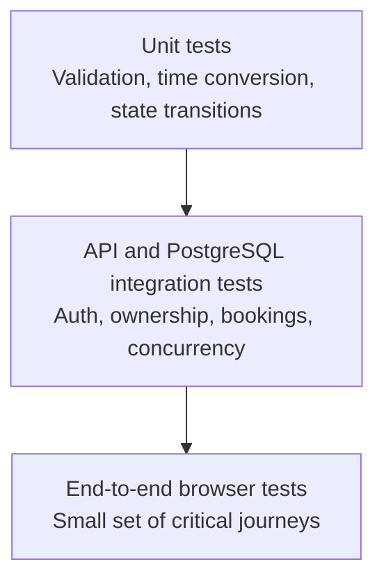
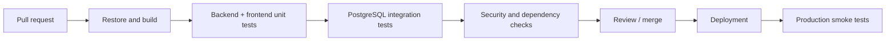

# BrightSmile Dental — Testing Strategy and Test Plan

**Project:** BrightSmile Dental  
**Status:** Test strategy and proposed automation plan; not a completed automated test suite  
**Sources:** Backend controller behavior, README manual verification record, and [requirements](REQUIREMENTS.md)

## 1. Objectives

Testing should establish that the application behaves correctly across its Angular client, ASP.NET Core API, and PostgreSQL database, with special attention to:

- Authentication, authorization and ownership restrictions.
- Appointment availability, business hours, status transitions and concurrency.
- Data validation, persistence and error responses.
- Safe database migrations and production deployment.
- Regression detection before changes are merged or deployed.

## 2. Current verification evidence

The backend README records manual Swagger API checks performed during 17–19 November 2026. **These are reported observations, not automated test results.**

| Scenario | Reported manual result |
| --- | --- |
| Admin and patient login | `200 OK` |
| Service create / list / update | `201 / 200 / 200` |
| Duplicate service name | `409 Conflict` |
| Patient attempts Admin-only service creation | `403 Forbidden` |
| Negative service price | `400 Bad Request` |
| Appointment creation | `201 Created` |
| Overlapping appointment | `409 Conflict` |
| Adjacent 30-minute booking | `201 Created` |
| Conflicting reschedule | `409 Conflict` |
| Valid reschedule | `200 OK` |
| Cancel and rebook released slot | `200 / 201` |

No automated pass rate, code coverage percentage, load-test throughput or CI build result is asserted here.

## 3. Proposed test pyramid

| Layer | Suggested tooling | Test scope |
| --- | --- | --- |
| Backend unit | xUnit or NUnit; assertion library | Isolated business rules and edge cases |
| Backend integration | ASP.NET Core `WebApplicationFactory`, test PostgreSQL | Real HTTP endpoints, EF Core persistence, JWT and advisory locks |
| Frontend unit/component | Angular test runner (configured `ng test` using Vitest) | Guards, components, services, forms and HTTP handling |
| Browser end-to-end | Playwright | Registration, login, role dashboards, booking and cancellation |
| API contract | OpenAPI schema checks | Request/response documentation consistency |
| Security regression | Automated authorization test matrix | Role and ownership denial cases |

These are **recommendations**, not claims that these frameworks or test projects have already been installed.

## 4. Test environment and isolation

- Run unit tests without production credentials or network dependencies.
- Use an isolated PostgreSQL database for integration tests. SQLite or EF Core InMemory alone cannot reproduce PostgreSQL advisory-lock behavior.
- Create and dispose of test accounts, dentists, services and appointments between tests.
- Freeze or inject time where possible; scheduling checks depend on UTC and SAST dates.
- Keep SMTP calls mocked or directed to a controlled test inbox.
- Never run destructive tests or demo-user seeding against the production Supabase database.
- Supply test secrets through local secret stores or CI secret variables, not repository files.

## 5. Test case catalogue

These identifiers map to the [SRS](REQUIREMENTS.md) and can become automated test names.

### Authentication and authorization

| Test ID | Scenario | Expected result |
| --- | --- | --- |
| T-AUTH-01 | Register a new patient with valid details | Account and profile persisted |
| T-AUTH-02 | Register an existing email | `409 Conflict` |
| T-AUTH-03 | Login with valid credentials | `200 OK`, valid JWT and role |
| T-AUTH-04 | Login with incorrect password | `401 Unauthorized` |
| T-AUTH-05 | Call protected endpoint without token | `401 Unauthorized` |
| T-AUTH-06 | Call Admin-only endpoint as Patient | `403 Forbidden` |
| T-AUTH-07 | Supply expired, tampered or wrong-audience JWT | Authentication rejected |
| T-AUTH-08 | Request reset for an unknown email | Generic response, no account disclosure |
| T-AUTH-09 | Use expired or reused password-reset token | Reset rejected |
| T-AUTH-10 | Successfully reset password | New BCrypt hash stored; token invalidated |

### Services, profiles and dentist directory

| Test ID | Scenario | Expected result |
| --- | --- | --- |
| T-DATA-01 | Fetch public service list | `200 OK` |
| T-DATA-02 | Admin creates valid service | `201 Created` |
| T-DATA-03 | Create duplicate service name | `409 Conflict` |
| T-DATA-04 | Submit invalid service price | `400 Bad Request` |
| T-DATA-05 | Delete service referenced by appointments | Request rejected |
| T-DATA-06 | Update own profile | Updated values returned and persisted |
| T-DATA-07 | Update profile with future birth date | `400 Bad Request` |
| T-DATA-08 | Fetch public dentist directory | `200 OK` |
| T-DATA-09 | Patient attempts admin dentist management | `403 Forbidden` |

### Appointment business rules

| Test ID | Scenario | Expected result |
| --- | --- | --- |
| T-APPT-01 | Patient books valid available weekday slot | `201 Created`; Pending |
| T-APPT-02 | Patient books an overlapping active slot | `409 Conflict` |
| T-APPT-03 | Patient books adjacent non-overlapping slot | Booking accepted |
| T-APPT-04 | Patient books outside 09:00–17:00 SAST | Request rejected |
| T-APPT-05 | Patient books weekend or invalid interval | Request rejected |
| T-APPT-06 | Patient books in past or beyond two-year limit | Request rejected |
| T-APPT-07 | Patient books nonexistent or non-dentist user | Request rejected |
| T-APPT-08 | Patient reschedules own eligible appointment | New time persisted |
| T-APPT-09 | Patient reschedules into occupied slot | `409 Conflict` |
| T-APPT-10 | Patient cancels eligible appointment | Cancelled status persisted |
| T-APPT-11 | Another patient books released cancelled slot | Booking accepted |
| T-APPT-12 | Patient accesses another patient's booking | Access denied |
| T-APPT-13 | Dentist accesses another dentist's booking | Access denied |
| T-APPT-14 | Assigned dentist confirms permitted appointment | Valid status transition persisted |
| T-APPT-15 | Invalid or forbidden status transition | Request rejected |
| T-APPT-16 | Two concurrent requests target same dentist and slot | At most one active booking succeeds |
| T-APPT-17 | Concurrent reschedule and booking target same slot | No double-booked active appointments |

**Concurrency requirement:** Test T-APPT-16 and T-APPT-17 with separate database connections against PostgreSQL. A sequential test alone cannot establish that advisory locks protect concurrent writes.

### Reporting and API documentation

| Test ID | Scenario | Expected result |
| --- | --- | --- |
| T-REPORT-01 | Admin requests valid reporting window | Expected aggregate shape and totals |
| T-REPORT-02 | Non-admin requests report | `403 Forbidden` |
| T-REPORT-03 | Invalid or oversized date range | `400 Bad Request` |
| T-REPORT-04 | Completed vs pending service values | Correct estimated categories; not represented as paid revenue |
| T-DOCS-01 | Open Scalar in configured environment | Reference UI loads |
| T-DOCS-02 | Fetch OpenAPI JSON | Valid OpenAPI document with expected endpoints |
| T-DOCS-03 | Call protected endpoint without JWT from Scalar | Authorization still enforced |

## 6. Test data matrix

| Dimension | Representative values |
| --- | --- |
| Roles | Visitor, Patient A, Patient B, Dentist A, Dentist B, Admin |
| Appointment statuses | Pending, Confirmed, Completed, Cancelled |
| Times | Before opening, 09:00, 09:30, 16:30, 17:00, weekend |
| Dates | Yesterday, today, next weekday, leap day, beyond two years |
| Services | Valid service, invalid price, duplicate name, referenced service |
| JWTs | Valid, missing, expired, tampered, wrong issuer/audience |
| Booking concurrency | Same dentist/same slot, same dentist/adjacent slots, different dentists |

Time-sensitive tests should calculate future weekdays dynamically rather than hardcoding dates that eventually expire.

## 7. CI/CD quality gates — proposed

Recommended first GitHub Actions workflow:

1. Trigger on pull requests and pushes to the main development branch.
2. Set up .NET 10 and a supported Node.js runtime.
3. Run `dotnet restore`, `dotnet build --no-restore`, and `dotnet test` for the backend.
4. Run `npm ci`, `npm run build`, and `npm test` for the Angular frontend.
5. Once integration tests exist, provision a disposable PostgreSQL service for API tests.
6. Block merges on failing required checks after the workflows have been verified.
7. Add controlled deployment and post-deploy smoke checks later.

**Current status:** This is a pipeline design. A workflow file and passing CI results must be created and observed before claiming CI/CD is operational.

## 8. Exit criteria and reporting

For each release, record:

- Git commit SHA, environment and build result.
- Number of tests executed, passed, failed and skipped.
- Known defects, severity and disposition.
- Schema migration status and rollback readiness.
- Smoke-test outcome for public endpoints, authentication and booking.
- Coverage metrics **only when actually measured**.

A release should not be described as fully tested solely because it deployed successfully.

## 9. Suggested implementation order

1. Add a backend test project and unit tests for booking validation and appointment state transitions.
2. Add API integration tests for registration, role authorization and ownership.
3. Add PostgreSQL-backed overlapping-booking and concurrency tests.
4. Add Angular service and component tests.
5. Add a small Playwright end-to-end suite.
6. Wire verified tests into GitHub Actions and enforce required checks.
7. Add dependency/security scanning and post-deployment smoke tests.

## 10. Related documentation

- [Software requirements](REQUIREMENTS.md)
- [Security design](SECURITY.md)
- [Architecture](ARCHITECTURE.md)
- [Database design](DATABASE.md)
- [Deployment guide](DEPLOYMENT.md)
- [Backend README](../README.md)
